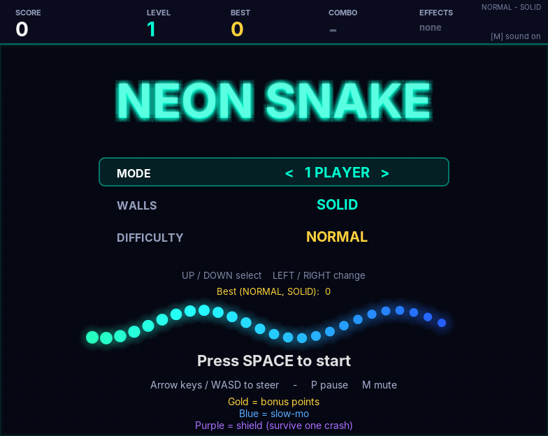
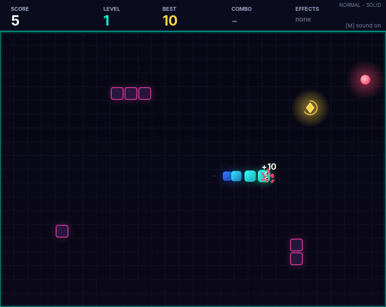
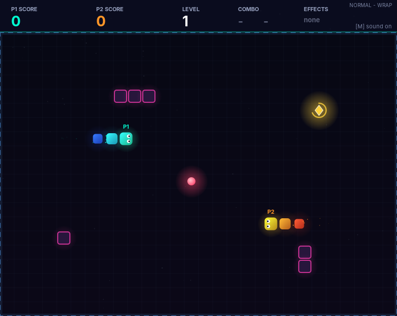

# Neon Snake

A glowing, arcade-style take on the classic Snake game, written in pure Java (Swing). No libraries, no build tools, no audio files: just one source file and the JDK.



## Features

- **1 or 2 players** on the same keyboard
- **Solid or wrap-around walls**
- **Three difficulties** (Easy, Normal, Hard) that change speed, speed-up rate and obstacle count
- **Smooth movement**: the snake glides between tiles instead of jumping
- **Power-ups**
  - Gold diamond: bonus points
  - Blue orb: slow-motion
  - Purple hexagon: shield that lets you survive one crash
- **Combo multiplier** (up to x5) for eating quickly
- **Levels**: every 5 apples the game speeds up and more obstacles appear
- **Neon effects**: glow, particle bursts, screen shake, floating score text, animated starfield
- **Built-in sound**: short beeps and jingles generated in code (press `M` to mute)
- **Saved high scores**, kept separately for each difficulty and wall setting

| One player | Two players (wrap-around) |
| :---: | :---: |
|  |  |

## Requirements

- **JDK 17 or newer** (JDK 14+ also works)

Check what you have with `java -version`.

## Run it

### In IntelliJ IDEA

1. Open the project folder (**File > Open**), or create a new Java project and copy `src/NeonSnake.java` into its `src` folder.
2. Make sure a JDK 17+ is selected (**File > Project Structure > Project SDK**).
3. Open `NeonSnake.java` and click the green play button next to `main`.

### From the command line

```bash
# compile
javac -d out src/NeonSnake.java

# run
java -cp out NeonSnake
```

## Controls

### Menu

| Key | Action |
| --- | --- |
| Up / Down (or W / S) | Choose an option |
| Left / Right (or A / D) | Change the option |
| Space / Enter | Start the game |
| M | Mute / unmute |

### In game

| Mode | Player 1 | Player 2 |
| --- | --- | --- |
| 1 player | Arrow keys **or** WASD | n/a |
| 2 players | WASD (cyan snake) | Arrow keys (orange snake) |

| Key | Action |
| --- | --- |
| Space / P | Pause / resume |
| M | Mute / unmute |
| Esc | Back to the menu |
| Space (after game over) | Play again |

## Rules

- Eat the red apples to grow and score points. Eating quickly builds a combo (x2 to x5).
- **Solid walls:** touching a wall, an obstacle or your own body ends the game.
- **Wrap-around walls:** you pass through an edge and come out the other side (the border turns blue and dashed). Obstacles and bodies still kill you.
- **Two players:** you can crash into each other, and a head-on collision kills both. The last snake alive wins; if both die on the same move, the higher score wins.
- A **shield** absorbs one crash. It breaks through an obstacle or lets you cross a wall, then disappears.
- Two-player games do not affect high scores.

## High scores

Best scores are saved in `.neon_snake_scores.properties` in your home folder, one entry per difficulty and wall setting. Delete the file to reset them.

## Project structure

```
NeonSnake/
├── src/
│   └── NeonSnake.java    # the whole game
├── docs/                 # screenshots used in this README
├── .gitignore
├── LICENSE
└── README.md
```

## Ideas for the future

- AI opponent for single-player versus mode
- A third player or team mode
- More power-ups and level layouts
- Gamepad support

## License

Released under the [MIT License](LICENSE).
